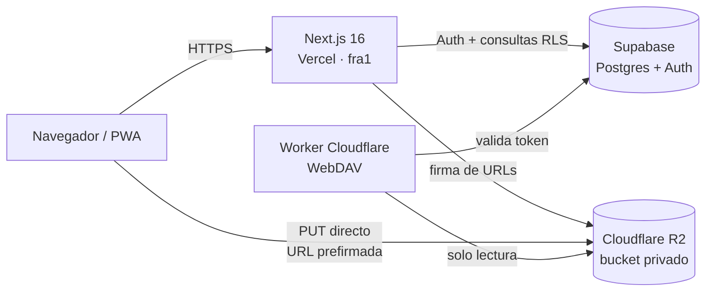

# Gestor Familiar

PWA privada de gestión documental para una familia: carpetas y archivos con permisos por usuario, almacenamiento propio en Cloudflare R2, enlaces compartidos con caducidad, favoritos, recordatorios e historial de actividad.


> **Demo:** [proyecto-gestor-archivos.vercel.app](https://proyecto-gestor-archivos.vercel.app) — el acceso es solo por invitación.
>
> **Licencia:** proyecto personal y propietario. Todos los derechos reservados; no es software libre. Consulta [Licencia](#licencia).

## Características

- **Espacios separados**: Área común para toda la familia, Mi caja fuerte privada de cada miembro y Compartido conmigo.
- **Archivos y carpetas**: creación, colores, renombrado en línea, movimiento por lotes, orden y vistas de cuadrícula o lista.
- **Papelera**: restauración y borrado definitivo reservado al administrador.
- **Subida directa a R2**: el navegador pide una URL prefirmada y sube el archivo sin pasar por el servidor. Límite de 20 MB por archivo y cuota familiar de 9 GB.
- **Compartir**: enlaces públicos con token y caducidad de 7 días, además de cesiones nominales a otros miembros con herencia de permisos en carpetas.
- **Búsqueda y accesos**: búsqueda global, recientes, favoritos, accesos directos y paleta de comandos con `Ctrl`/`⌘` + `K`.
- **Portada**: resumen de almacenamiento, últimas carpetas, actividad reciente y recordatorios.
- **Auditoría y administración**: historial inmutable de actividad, gestión de usuarios e invitaciones de un solo uso.
- **PWA**: instalable, Share Target en Android, «Abrir con» en Chromium de escritorio y subida por API para el Atajo de iOS.
- **WebDAV de solo lectura**: monta los archivos en el explorador del sistema mediante un Worker aparte de Cloudflare.
- **Interfaz oscura y responsive**, con avisos propios en lugar de `alert`/`confirm` nativos.

## Stack

| Capa | Tecnología |
| --- | --- |
| Framework | Next.js 16 (App Router) + React 19 |
| Lenguaje | TypeScript 5 en modo `strict` |
| Autenticación y metadatos | Supabase (PostgreSQL + Auth SSR + RLS) |
| Ficheros | Cloudflare R2 (S3 compatible) |
| Despliegue | Vercel (región `fra1`) |
| Worker | Cloudflare Workers + R2 (WebDAV) |
| Estilos | CSS propio con variables y tema oscuro |

## Arquitectura



En la subida normal los archivos no pasan por Vercel: el navegador los envía directamente a R2 con una URL prefirmada. El servidor solo genera la firma y registra los metadatos.

### Aspectos técnicos destacados

- **Subida directa a R2** con URLs prefirmadas de corta duración; los bytes nunca atraviesan el servidor de la aplicación.
- **RLS como autorización real**: los permisos viven en PostgreSQL y se aplican aunque alguien manipule el cliente.
- **PWA bidireccional**: Share Target en Android, File Handling en Chromium y API con token para el Atajo de iOS.
- **Puente WebDAV** en un Worker de Cloudflare para montar los archivos en el explorador del sistema.
- **Invitaciones con reclamo de un solo uso** y cookie `HttpOnly`, sin enlaces reutilizables.
- **Auditoría inmutable**: el historial se escribe desde el servidor y no admite `UPDATE` ni `DELETE`.

## Cómo funciona la subida

1. El cliente llama a `getUploadUrl()` (`actions/files.ts`), que valida el tamaño y genera la clave de R2 según el ámbito: `comun/...`, `usuarios/<id>/publico/...` o `usuarios/<id>/privado/...`.
2. `UploadModal.tsx` hace un `PUT` directo a R2 con la URL prefirmada. Solo envía la cabecera `Content-Type` y `credentials: 'omit'`; cualquier cabecera extra invalida la firma.
3. `registrarArchivo()` inserta la fila en `archivos`. Un trigger de PostgreSQL rechaza la subida si se supera la cuota de 9 GB.

Las URLs prefirmadas caducan a los 5 minutos para subir y a los 15 minutos para visualizar o descargar. El bucket es privado: no hay acceso público sin firma.

## Puesta en marcha

Requisitos: Node.js 20.9 o superior, un proyecto de Supabase y un bucket de Cloudflare R2.

```bash
git clone https://github.com/herizador/Proyecto-Gestor-Archivos.git
cd Proyecto-Gestor-Archivos
npm install
```

1. **Variables de entorno**: copia `.env.example` a `.env.local` y rellena los valores.

   ```powershell
   Copy-Item .env.example .env.local
   ```

2. **Supabase**: crea el proyecto y ejecuta `supabase/schema.sql` completo en *SQL Editor*. Incluye tablas, funciones, triggers y políticas RLS. Los archivos `supabase/migraciones/*.sql` son parches para instalaciones ya existentes, no hacen falta en una instalación nueva.

3. **Cloudflare R2**: crea un bucket privado y un token de API con permisos de lectura y escritura de objetos. Configura CORS para aceptar subidas desde el origen de la app:

   ```json
   [
     {
       "AllowedOrigins": ["http://localhost:3000", "https://tu-app.vercel.app"],
       "AllowedMethods": ["GET", "PUT", "HEAD"],
       "AllowedHeaders": ["*"],
       "ExposeHeaders": ["ETag"],
       "MaxAgeSeconds": 3600
     }
   ]
   ```

   Comprueba el bucket y la política aplicada con `npm run r2:diagnostico` y `npm run r2:cors` (sin `--aplicar` solo muestra lo que hay).

   Si al subir o abrir archivos aparece `Failed to fetch`, un error de certificado o la nota de LaLiga, **no es CORS**: consulta [`docs/guias/incidencias-r2.md`](docs/guias/incidencias-r2.md).

4. **Arranque**:

   ```bash
   npm run dev
   ```

   La app queda en [http://localhost:3000](http://localhost:3000).

Las invitaciones necesitan además la plantilla de correo y la configuración de URL de Supabase que se describen en [`docs/guias/invitaciones.md`](docs/guias/invitaciones.md).

## Variables de entorno

| Variable | Ámbito | Uso |
| --- | --- | --- |
| `NEXT_PUBLIC_SUPABASE_URL` | Público | URL del proyecto de Supabase |
| `NEXT_PUBLIC_SUPABASE_ANON_KEY` | Público | Clave anónima de Supabase |
| `SUPABASE_SERVICE_ROLE_KEY` | Solo servidor | Invitaciones y `/api/subir`; **nunca** en el cliente |
| `CLOUDFLARE_R2_ENDPOINT` | Solo servidor | Endpoint S3 de R2 |
| `CLOUDFLARE_R2_ACCESS_KEY_ID` | Solo servidor | Credencial de acceso a R2 |
| `CLOUDFLARE_R2_SECRET_ACCESS_KEY` | Solo servidor | Secreto de acceso a R2 |
| `CLOUDFLARE_R2_BUCKET_NAME` | Solo servidor | Nombre del bucket |
| `NEXT_PUBLIC_APP_URL` | Público | Base de los enlaces de `/compartir`; obligatoria en producción |

No prefijes con `NEXT_PUBLIC_` ninguna credencial de R2 ni la service-role: quedarían expuestas en el bundle del navegador.

## Scripts

```bash
npm run dev      # servidor de desarrollo
npm run build    # build de producción (verificación principal)
npm run start    # servidor de producción
npm run lint     # ESLint

npm run r2:diagnostico  # ¿R2 responde? ¿es un bloqueo de red? ¿qué CORS hay?
npm run r2:cors         # muestra la política CORS (-- --aplicar para escribirla)
```

El proyecto no tiene framework de tests: cada cambio se verifica con `npm run lint` y `npm run build`.

## Estructura

```text
actions/        Server Actions (auth, archivos, carpetas, compartir, mover, selección...)
app/            Rutas del App Router: login, dashboard, admin, /compartir, /recibir, /abrir y API
components/     Componentes de interfaz (tarjetas, modales, navegación, paleta de comandos...)
lib/            Clientes de Supabase y R2, URLs prefirmadas, helpers y estado de selección
supabase/       schema.sql (esquema completo) y migraciones/ (parches incrementales)
types/          Tipos de la base de datos (espejo manual del esquema)
worker/         Worker de Cloudflare con el puente WebDAV de solo lectura
docs/           guias/ (uso) y diseno/ (decisiones técnicas)
public/         Manifiesto PWA, service worker e iconos
```

Rutas principales: `/inicio`, `/todos`, `/compartido`, `/favoritos`, `/recientes`, `/familia`, `/mi-caja-fuerte`, `/papelera`, `/ajustes`, `/admin/historial`, `/admin/usuarios`, `/login` y `/compartir?token=...`.

## Despliegue

- **Vercel**: importa el repositorio, define las variables de entorno y mantén la región `fra1` de `vercel.json` (junto a Supabase en `eu-central-1`). Define `NEXT_PUBLIC_APP_URL` con el dominio final.
- **Worker WebDAV**: se despliega aparte, desde `worker/`, con `npx wrangler deploy`. El secreto se configura con `npx wrangler secret put SUPABASE_SERVICE_ROLE_KEY`; nunca se escribe en `wrangler.toml`.
- **Service worker**: si cambias el comportamiento de `public/sw.js`, sube la versión de `CACHE_NAME` para que los dispositivos instalados descarten la caché anterior.
- **Caché HTTP**: las vistas dinámicas se sirven con `no-store`; los estáticos de `/_next/static` e iconos quedan excluidos a propósito.

Prueba de humo del puente WebDAV:

```bash
node worker/test/smoke.mjs <base> <email> <token> [ruta-archivo]
```

## Seguridad y datos

- **RLS es la capa de autorización**: las consultas usan la sesión del usuario y no se salta RLS en el código de servidor.
- La service-role se usa solo en rutas concretas de servidor (`/api/subir` e invitaciones) y nunca se envía al navegador.
- El bucket de R2 es privado; el acceso se hace con URLs prefirmadas de corta duración.
- `historial_actividad` es inmutable: las políticas no permiten `UPDATE` ni `DELETE` desde la aplicación.
- La cuota de 9 GB se valida en la base de datos, no solo en el cliente.

## Limitaciones conocidas

- El Share Target del sistema está limitado a unos 4,5 MB por envío en Vercel; la subida normal admite 20 MB.
- Los enlaces de `/compartir` resuelven archivos; las carpetas incluidas en un enlace aún no se navegan.
- El puente WebDAV es de solo lectura. La escritura está especificada en [`docs/diseno/webdav-escritura.md`](docs/diseno/webdav-escritura.md), pero no implementada.
- «Abrir con» (File Handling) solo funciona en Chromium de escritorio.
- iOS no admite Web Share Target: se usa el Atajo + API o la subida manual.

## Documentación

Índice completo en [`docs/README.md`](docs/README.md).

- [`docs/guias/invitaciones.md`](docs/guias/invitaciones.md): flujo de invitación, reclamo de un solo uso y SMTP propio.
- [`docs/guias/alta-explorador.md`](docs/guias/alta-explorador.md): crear un token y montar el WebDAV en el explorador.
- [`docs/guias/atajo-ios.md`](docs/guias/atajo-ios.md): Atajo de iOS contra `/api/subir`.
- [`docs/diseno/compartidos.md`](docs/diseno/compartidos.md): cesiones nominales y herencia de permisos.
- [`docs/diseno/webdav.md`](docs/diseno/webdav.md): diseño del puente WebDAV.
- [`docs/diseno/webdav-escritura.md`](docs/diseno/webdav-escritura.md): especificación futura de escritura.

## Licencia

Copyright © 2026 Ismael Mateo Díaz Gutiérrez. **Todos los derechos reservados.**

Este repositorio es un proyecto personal y propietario. No se concede permiso para copiar, modificar, distribuir, sublicenciar ni explotar comercialmente el código sin autorización previa y por escrito. Consulta [`LICENSE`](LICENSE) para los términos completos.

Las dependencias y recursos de terceros conservan sus propias licencias.

## Autor

**Ismael Mateo Díaz Gutiérrez** — [ismel386827@gmail.com](mailto:ismel386827@gmail.com)
